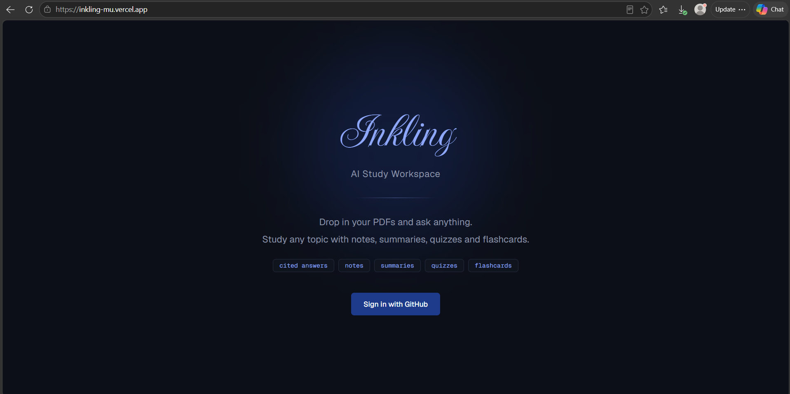
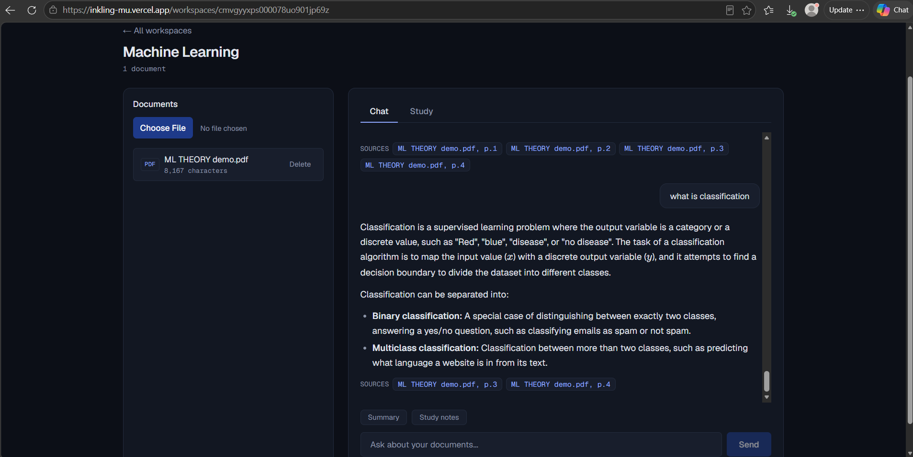
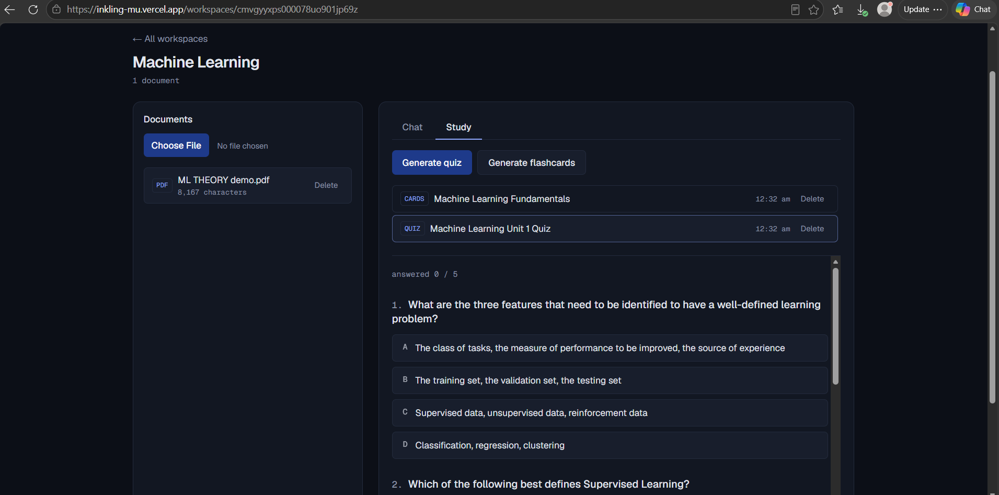
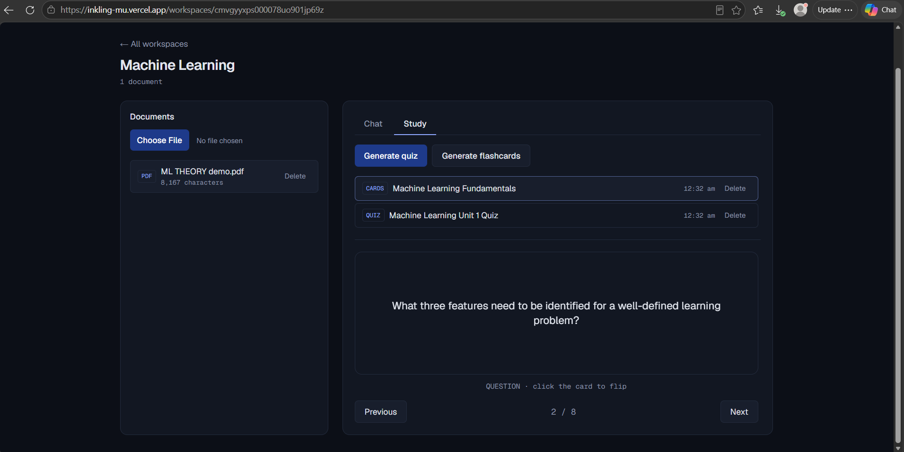
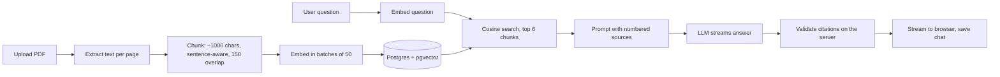

# Inkling

**An AI study workspace.** Upload your PDFs, chat with an AI that answers only from your documents (with page-level source citations), then turn the material into quizzes and flashcards.

**Live demo: [inkling-mu.vercel.app](https://inkling-mu.vercel.app)** (sign in with GitHub)



## Features

- **Chat grounded in your documents.** Answers come only from your PDFs. If the answer isn't there, Inkling says so instead of guessing.
- **Source citations.** Every answer shows chips like `ML THEORY demo.pdf, p.2`, validated on the server against what was actually retrieved.
- **Streaming answers.** Words appear as they are generated.
- **Quizzes and flashcards.** Generated from material sampled across all your documents, with instant right/wrong feedback and a 3D flip card.
- **Math rendering.** LaTeX in answers is rendered with KaTeX.
- **Private by design.** GitHub sign-in, per-user data isolation, and a per-user daily AI usage limit.
- **Designed for long study sessions.** A calm dark theme (no pure black or white), a muted navy accent, and a responsive layout that works on phones.

| Chat with citations | Quiz |
|---|---|
|  |  |



## How it works



**Indexing (on upload).** The PDF is read page by page so each chunk keeps its page number. Text is split into roughly 1,000-character chunks that break on sentence boundaries, with 150 characters of overlap so a fact split across a boundary is still retrievable. Chunks are embedded (768 dimensions) and stored in a `vector(768)` column. If indexing fails, the document is deleted so no half-indexed file is left behind.

**Answering (on each question).** The question is embedded and compared with `<=>` (cosine distance) against only the chunks that belong to that workspace and that user. The top 6 chunks are sent to the model as excerpts labelled `[Source 1]`, `[Source 2]`, and so on. Short follow-ups like "explain that more" borrow the previous question for retrieval, since they have no searchable meaning on their own.

**Citing.** The model cites by number. The server maps each number back to a real retrieved chunk, ignores numbers the model made up, strips the markers from the text, and saves only the sources that were actually cited.

**Streaming.** The chat route returns newline-delimited JSON (`delta`, then `done` or `error`). The server saves the conversation after the last word, and the client hides `[Source N]` markers while text arrives.

**Quizzes and flashcards.** Instead of pasting whole documents into the prompt, the app samples 12 evenly spaced chunks in reading order, asks for JSON, validates it with Zod, and retries once if the model returns something invalid.

## Design decisions

- **pgvector inside Postgres, not a separate vector database.** Documents, users and vectors live in one database, so ownership filtering is a single SQL join and there is one less service to run.
- **Sentence-aware chunks with overlap.** Cutting mid-sentence hurts embedding quality, and overlap protects facts that straddle a boundary.
- **Citations validated on the server.** The model is not trusted to cite correctly. Only citation numbers that map to real retrieved chunks survive, so a source chip can never point at something that wasn't retrieved.
- **Six chunks instead of the single best match.** Vector search alone can rank a wrong chunk first (for example, near-identical templates), and sending several compensates.
- **NDJSON over a `ReadableStream`.** It is simple to parse, works on serverless, and lets errors after streaming starts be reported as events.
- **Ownership checked inside every query.** Each query filters by the signed-in user, rather than relying on a separate check that could be forgotten. There is no shared middleware, so every route and page checks for itself.
- **Rolling 24-hour rate limit.** A `UsageEvent` table caps AI requests per user (default 30, configurable), which protects the free-tier API key.
- **Model output treated as untrusted.** Quiz JSON is validated with Zod, and messages sent to the model are reduced to `{ role, content }` so the extra `sources` field is never sent to the API.
- **Tabs stay mounted.** Chat and Study are hidden, not unmounted, so a streaming answer keeps running if the student switches tabs.

## Tech stack

- **Framework:** Next.js 16 (App Router, Turbopack), React 19, TypeScript
- **Styling:** Tailwind CSS v4 with design tokens in CSS variables; Geist, Geist Mono and Imperial Script via `next/font`
- **Database:** Prisma 7 with `@prisma/adapter-pg` on Prisma Postgres, with pgvector
- **Auth:** Auth.js v5 (GitHub sign-in, JWT sessions)
- **AI:** Google Gemini (free tier) through the `openai` package and Google's OpenAI-compatible endpoint; text generation and embeddings
- **Other:** `unpdf` (PDF text extraction), `zod` (validating model JSON), `react-markdown` with `remark-gfm`, `remark-math`, `rehype-katex` and `katex`
- **Hosting:** Vercel, auto-deployed from `main`

## Running locally

**Prerequisites:** Node.js, a Postgres database with the pgvector extension, a GitHub OAuth app, and a Google AI API key.

1. Install dependencies:

```bash
   npm install
```

2. Create a `.env` file in the project root with these variables (set your own values; never commit this file):

```
   DATABASE_URL=
   AUTH_SECRET=
   AUTH_GITHUB_ID=
   AUTH_GITHUB_SECRET=
   AI_API_KEY=
   AI_BASE_URL=
   AI_MODEL=
   AI_EMBEDDING_MODEL=
   # optional, defaults to 30 AI requests per user per rolling 24 hours
   DAILY_AI_LIMIT=
```

3. Apply the database migrations and generate the Prisma client:

```bash
   npx prisma migrate dev
```

4. Start the dev server and open [http://localhost:3000](http://localhost:3000):

```bash
   npm run dev
```

For GitHub sign-in locally, create a GitHub OAuth app whose callback URL is `http://localhost:3000/api/auth/callback/github`. In production, use a separate OAuth app with your deployed domain.

## Scripts

One-time helper scripts live in `scripts/`. Run them with:

```bash
npx tsx --env-file=.env ./scripts/<file>.ts
```

| Script | What it does |
|---|---|
| `index-existing-documents.ts` | Backfills chunks and embeddings for documents uploaded before RAG existed |
| `count-chunks.ts` | Prints chunk counts and page numbers per document (Prisma Studio can't open the vector table) |
| `test-retrieval.ts` | Runs a retrieval query from the command line: `... ./scripts/test-retrieval.ts "your question"` |

## Known limitations

- **Retrieval is vector-only.** There is no keyword or hybrid search, and near-identical passages can rank the wrong chunk first. Sending six chunks to the model compensates.
- **Scanned PDFs aren't supported.** Text is extracted directly, so image-only PDFs are rejected. OCR is a possible future addition.
- **Documents indexed before page tracking** (via the backfill script) have no page numbers, so their citations show only the file name. Re-uploading fixes this.
- **Quizzes and flashcards use a deterministic even spread**, so generating twice produces similar source material.
- **Free-tier model.** Occasional invalid JSON (retried once), occasionally ignored instructions, and a few seconds of latency before the first word. Model names are retired periodically, so `AI_MODEL` may need updating.
- **Usage limit.** The 429 response doesn't yet say when the next request opens up.